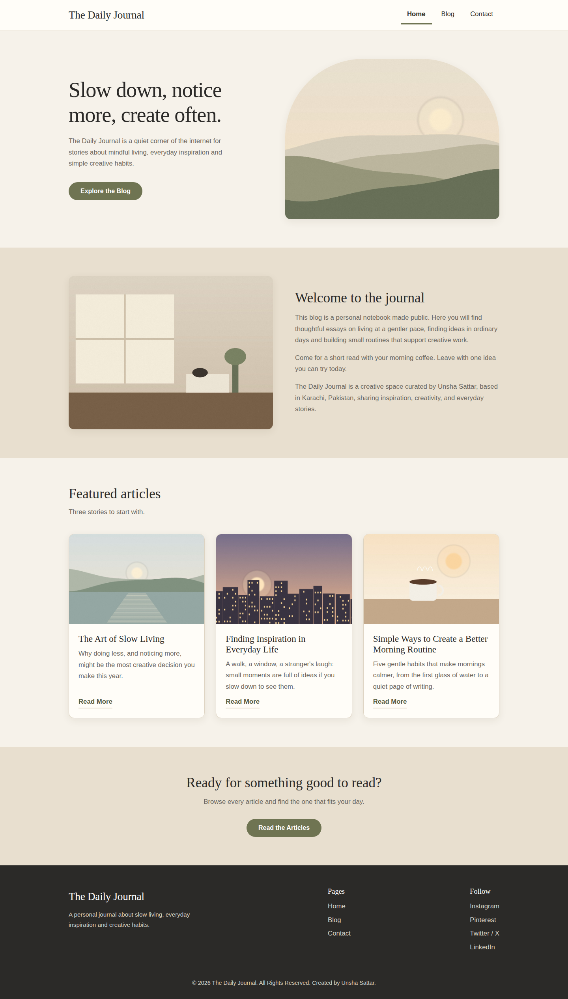
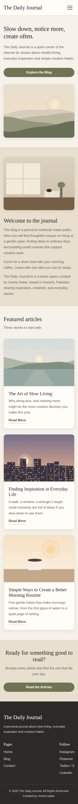
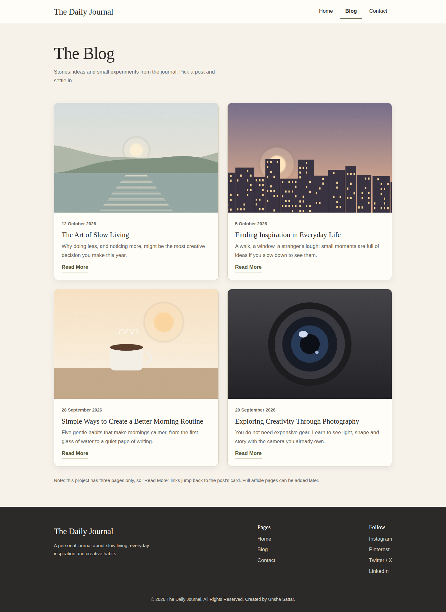
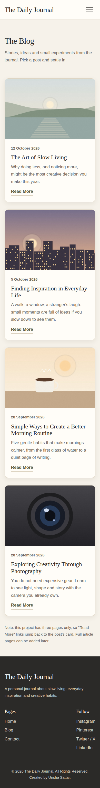
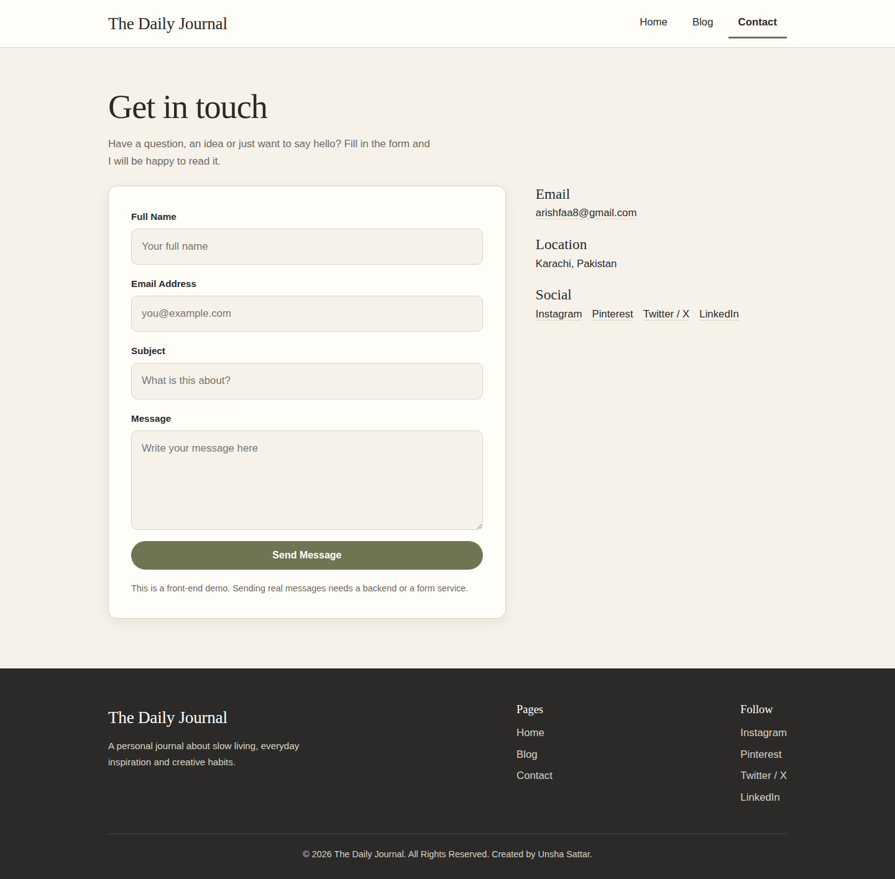
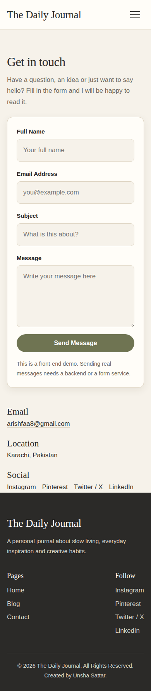

# The Daily Journal - Multi-Page Blog Website

**The Sky Gen - Web Development, Project 03 (Beginner)** | Ref: TSG/WD/P03/2026

Created by **Unsha Sattar** (Karachi, Pakistan). A three-page blog website about slow living, everyday inspiration and creative habits. It shows multi-page navigation, one shared stylesheet, consistent design and an organised folder structure.

## Technologies
HTML5, CSS3, CSS Flexbox, Google Fonts (Newsreader, DM Sans). No JavaScript, no frameworks.

## Pages
| Page | File | What it has |
|---|---|---|
| Home | `index.html` | Hero, introduction, 3 featured articles, call to action |
| Blog | `blog.html` | Exactly 4 post cards (image, title, date, preview, Read More) |
| Contact | `contact.html` | Styled form with HTML validation, contact details |

## Features
- Identical header, navigation and footer on every page
- Active page indicator in the navigation
- CSS-only mobile menu (hidden checkbox)
- Responsive Flexbox layout, tested at 1440, 1024, 768, 390 and 360 px with no horizontal scrolling
- The contact form is a **front-end demo**. It does not send messages. Real delivery needs a backend or a form service.
- On the blog page, "Read More" links jump to the post's card because article pages are outside this 3-page project.

## Folder structure
```
tsg-webdev-p03-unsha-sattar/
├── index.html
├── blog.html
├── contact.html
├── css/style.css
├── images/ (hero-image, about-image, blog-post-1..4 .jpg)
├── screenshots/
├── README.md
└── .gitignore
```

## Run locally
Double-click `index.html`, or in VS Code right-click it and choose "Open with Live Server".

## Image credits
The placeholder images in `images/` were generated as original illustrations for this project, so no third-party credit is needed. To use photos instead, replace each file with a royalty-free one (Unsplash or Pexels) using the same filename and list the photographer here.

## Screenshots
| | Desktop | Mobile |
|---|---|---|
| Home |  |  |
| Blog |  |  |
| Contact |  |  |

## Author
- Name: Unsha Sattar
- Location: Karachi, Pakistan
- Email: arishfaa8@gmail.com
- LinkedIn: https://www.linkedin.com/in/unsha-sattar-b544b8365/

## Links
- GitHub repository: _add your link here_
- Live website: _add your link here_
